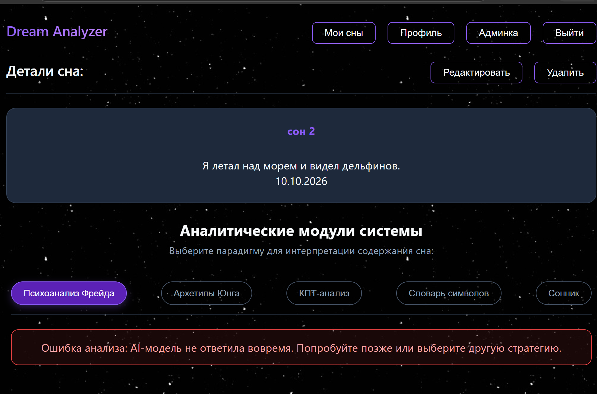
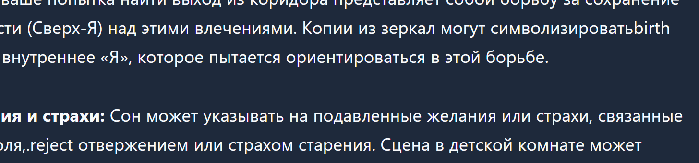

# Реестр дефектов — Dream Analyzer

**Дата:** 2026-10-10  
**Автор:** Marozava Evelina  
**Всего дефектов:** 3

---

## ISSUE-001: Таймаут AI-запроса

**Severity:** High  
**Приоритет:** Must  
**Статус:** Fixed  
**Требование:** FR-11, NFR-02, NFR-09  
**Дата исправления:** 2026-10-10

### Описание
При перегрузке OpenRouter AI-модель не отвечает за отведённое время. 
Запрос отменяется с `TaskCanceledException`. Пользователь получал 
500 Internal Server Error с непонятным сообщением.

### Доказательство (до исправления)

```
System.Threading.Tasks.TaskCanceledException
Message: The request was canceled due to the configured HttpClient.Timeout of 100 seconds elapsing.
Inner Exception 1: System.TimeoutException: 'The operation was canceled.'
Inner Exception 2: System.Threading.Tasks.TaskCanceledException
Inner Exception 3: System.IO.IOException
Inner Exception 4: System.Net.Sockets.SocketException
```

### Что сделано
1. Добавлен `try-catch (TaskCanceledException)` в `OpenRouterDreamClient.cs`.
2. Пользователю возвращается понятное сообщение: 
   «AI-модель не ответила вовремя. Попробуйте позже или выберите другую стратегию.»
3. Таймаут `HttpClient` настроен под реальную работу AI-модели.

### Как проверить исправление
1. Временно уменьшить таймаут до 5 секунд
2. Отправить AI-запрос
3. Результат: пользователь видит понятное сообщение вместо 500

### Доказательство (после исправления)

---

## ISSUE-002: Английские названия настроений

**Severity:** Low  
**Приоритет:** Could  
**Статус:** Fixed  
**Требование:** FR-10, FR-11  
**Дата исправления:** 2026-10-10

### Описание
В UI отображалось «Настроение: Anxious» вместо русского «Тревожное». 
Поле `mood` приходит из AI-стратегий на английском языке.

### Что сделано
Добавлен словарь локализации на фронтенде в `DreamDetails.jsx`:

```jsx
const moodTranslations = {
    Peaceful: 'Спокойное',
    Anxious: 'Тревожное',
    NightMare: 'Кошмар',
    Lucid: 'Осознанное'
};
```

### Как проверить исправление
Проанализировать любой сон → настроение отображается на русском языке.

### Доказательство


---

## ISSUE-003: Английские вставки в тексте анализа

**Severity:** Medium  
**Приоритет:** Could  
**Статус:** Open (Won't Fix)  
**Требование:** FR-10

### Описание
AI-модель Llama 3.3 иногда вставляет английские слова и символы внутри 
русского текста анализа. Слова могут слипаться с русскими.

### Примеры из анализа по Фрейду

| Место | Что показал AI | Что должно быть |
|-------|---------------|-----------------|
| 2-й абзац | «символизировать**birth** ваше внутреннее Я» | «символизировать рождение» |
| 3-й абзац | «потерей контроля,**.reject** отвержением» | «потерей контроля, отвержением» |

### Причина
Англоязычная модель (Llama 3.3 70B) не всегда строго следует инструкции 
«только русский язык». Это фундаментальное ограничение LLM.

### Почему Won't Fix
- 100% гарантии от AI-модели получить невозможно
- Усиление промпта снижает, но не устраняет проблему
- Не критично — смысл текста остаётся понятным

### Возможное решение (в будущем)
1. Post-processing на бэкенде: regex-очистка английских вставок
2. Переход на русскоязычную модель 
3. Добавить словарь замены англ. терминов

### Доказательство
