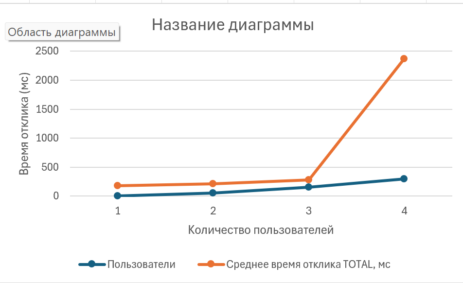

# Отчет о нагрузочном тестировании

**Дата:** 2026-10-19  
**Инструмент:** Apache JMeter  
**Окружение:** Localhost, PostgreSQL 16.

## 1. Метрики прогонов

| Тип теста | Пользователи (Threads) | Пропускная способность (Throughput) | Среднее время (Avg) | Макс. время (Max) | Доля ошибок (Error %) |
| :--- | :--- | :--- | :--- | :--- | :--- |
| **Базовый** | 1 | 5.5 req/sec | 182 мс | 354 мс | 0% |
| **Нагрузочный** | 50 | 9.8 req/sec | 212 мс | 607 мс | 0% |
| **Стресс-тест (1)** | 150 | 28.7 req/sec | 279 мс | 877 мс | 0% |
| **Стресс-тест (2)** | 300 | 28.5 req/sec | 2373 мс | 8293 мс | 0% |

## 2. График зависимости времени отклика от количества пользователей
*(Скриншот графика, построенного по данным из таблицы)*

## 3. Определение точки деградации
На графике четко видно, что до 150 пользователей система работает стабильно, а время отклика остается в пределах нормы (NFR-01: ≤ 500 мс).
**Точка деградации наступает при нагрузке в 300 одновременных пользователей.** 
Пропускная способность (Throughput) упирается в потолок ~28 запросов/сек, а среднее время отклика вырастает до 2.3 секунды (максимальное — 8.2 секунды). Система перестает справляться с очередью запросов.

## 4. Предположение об узком месте
Анализ логов JMeter показал, что основной вклад в деградацию вносит эндпоинт **`/api/authentication/login`** (его время выросло с 400 мс до 3.8 секунды). 
Наиболее вероятные узкие места в приложении:
1. **Высокая нагрузка на CPU (BCrypt):** Хеширование паролей с помощью алгоритма BCrypt — намеренно ресурсоемкая операция. При 300 одновременных попытках входа процессор на 100% загружен вычислениями, из-за чего остальные запросы (например, получение снов) вынуждены ждать освобождения потоков (Thread Pool Starvation).
2. **Отсутствие Rate Limiting (Ограничения запросов):** Сервер принимает все 300 запросов на логин одновременно. Внедрение ограничителя (например, не более 10 попыток входа в секунду с одного IP) позволило бы избежать перегрузки.
3. **Пул соединений PostgreSQL:** Запросы к БД замедлились с 15 мс до 941 мс, что может указывать на ожидание свободного соединения из стандартного пула (по умолчанию ограничен).