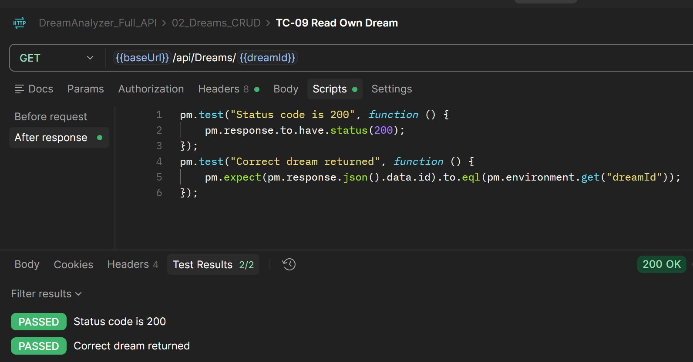
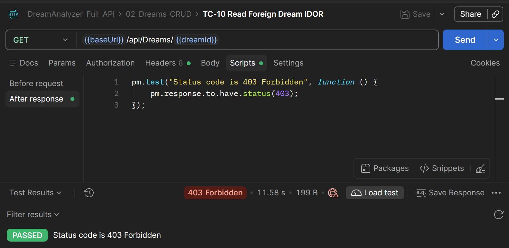
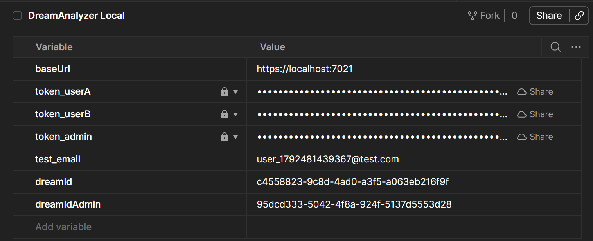
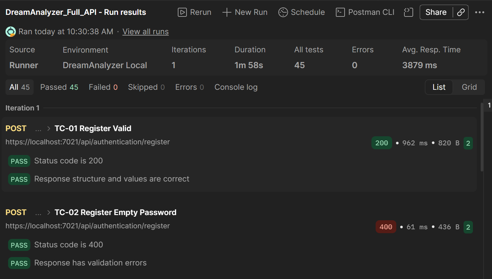

# Отчет о тестировании API в Postman

**Дата:** 2026-10-19  
**Инструмент:** Postman  
**Окружение:** Localhost, PostgreSQL 16  
**Тестируемая коллекция:** `DreamAnalyzer_Full_API.postman_collection.json` (приложена в репозитории)

---

## 1. Позитивные проверки
В ходе тестирования были проверены все основные сценарии работы API (регистрация, логин, CRUD снов, анализ, получение статистики). 
Для каждого позитивного запроса в Postman написаны скрипты (вкладка Tests), которые проверяют:
*   **Код ответа:** строго `200 OK`.
*   **Структуру ответа:** наличие объекта `data`, поля `success: true`.
*   **Значения полей:** наличие и корректность JWT-токена, корректность переданного email.

*Пример проверки (TC-01 Регистрация с валидацией полей):*

---

## 2. Негативные проверки
Были проверены следующие негативные сценарии для проверки отказоустойчивости и безопасности API:
*   **Без авторизации:** Попытка получить доступ к защищенному эндпоинту без заголовка `Authorization` возвращает `401 Unauthorized`.
*   **С некорректными данными:** Регистрация с пустым паролем, дублирование email, запрос с битым JSON возвращают `400 Bad Request` (или `401` для дубля).
*   **К несуществующим ручкам:** Запрос на несуществующий URL (`/api/this-endpoint-does-not-exist`) возвращает `404 Not Found`.
*   **Нарушение прав доступа (IDOR):** Попытка пользователя Б прочитать или отредактировать сон пользователя А по его ID возвращает `403 Forbidden` (доступ запрещен).

*Пример проверки (TC-10 IDOR: чтение чужого сна):*

---

## 3. Связывание запросов (Chaining)
В коллекции реализовано динамическое связывание запросов, что позволяет запускать коллекцию многократно без ручного вмешательства:
1.  В запросе `TC-01` (Pre-request Script) генерируется уникальный `test_email`.
2.  В запросе `TC-04` (Login) из ответа извлекается JWT-токен и сохраняется в переменную окружения `{{token_userA}}`.
3.  В запросе `TC-07` (Create Dream) из ответа извлекается ID сна и сохраняется в `{{dreamId}}`.
4.  Все последующие запросы (чтение сна, анализ, удаление) автоматически подставляют эти переменные в URL и Headers.

*Скриншот скрипта сохранения токена в TC-04:*

---

## 4. Запуск коллекции (Collection Runner)
Коллекция была полностью запущена через встроенный Collection Runner. 
Результат прогона: **27 запросов, 27 тестов пройдено (Passed), 0 упало (Failed)**. 
Это подтверждает, что вся цепочка от регистрации до удаления сна работает стабильно.

*Результаты прогона Collection Runner:*

---
**Вывод:** API Dream Analyzer успешно прошло функциональное тестирование. Все позитивные и негативные сценарии отрабатывают согласно спецификации. Ошибок, раскрывающих стек вызовов или внутренние данные сервера, не обнаружено.