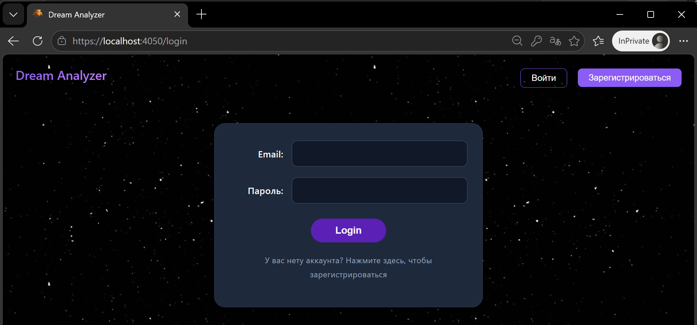
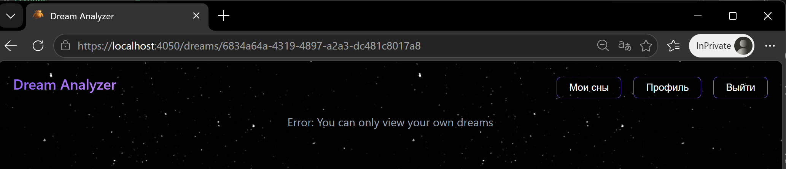
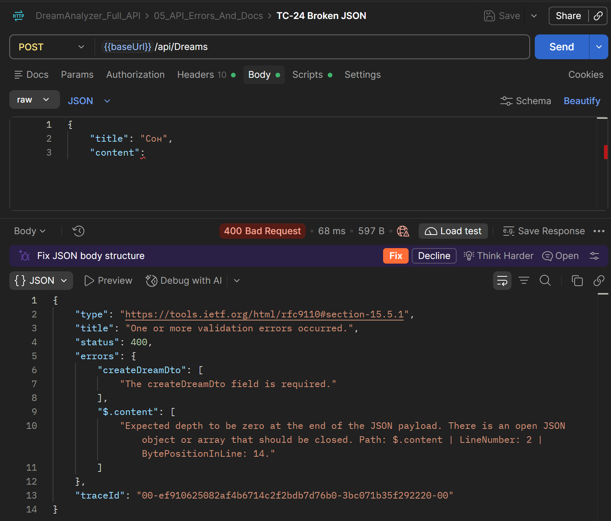
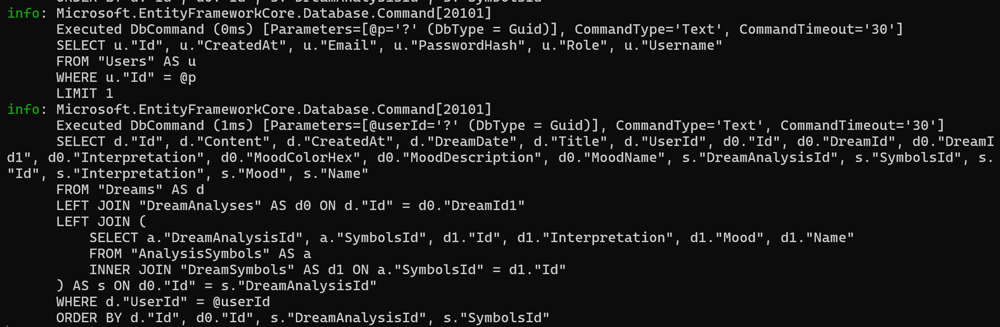

# Отчет о базовых проверках безопасности

**Дата:** 2026-10-19  
**Окружение:** Localhost.

## 1. Доступ в авторизованную зону без авторизации
*   **Проверка:** Попытка открыть `http://localhost:4050/dreams` в режиме инкогнито (без токена).
*   **Результат:** Passed. Компонент `PrivateRoute` перенаправляет неавторизованного пользователя на страницу `/login`.
*   **Скриншот:** 

## 2. Подмена идентификатора (IDOR)
*   **Проверка:** Попытка получить доступ к чужому сну по ID (проверено в Postman TC-10 и TC-12, а также через URL в браузере).
*   **Результат:** Passed. Бэкенд возвращает `403 Forbidden`. В браузере отображается ошибка загрузки, данные чужого сна не утекают.
*   **Скриншот:** 

## 3. Сообщения об ошибках (безопасность)
*   **Проверка:** Отправка некорректных данных (битый JSON) на эндпоинт.
*   **Результат:** Passed. `ExceptionHandlingMiddleware` перехватывает исключения и возвращает структурированный JSON. Стек вызовов (Stack Trace), SQL-запросы и пути к файлам сервера в ответе не раскрываются.
*   **Скриншот:** 

## 4. Логирование
*   **Проверка:** Мониторинг консоли бэкенда при выполнении запросов.
*   **Результат:** Passed. ASP.NET Core логирует все входящие запросы. При возникновении исключений `ExceptionHandlingMiddleware` записывает их через `ILogger` с уровнем Error.
*   **Скриншот:** 

**Вывод:** Базовые механизмы безопасности (JWT-авторизация, изоляция данных, обработка ошибок) работают корректно.