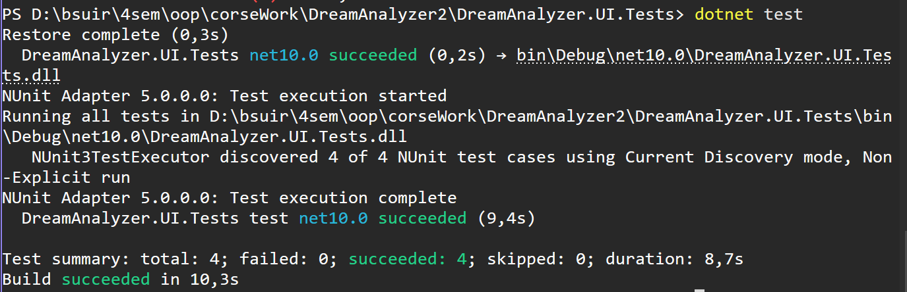
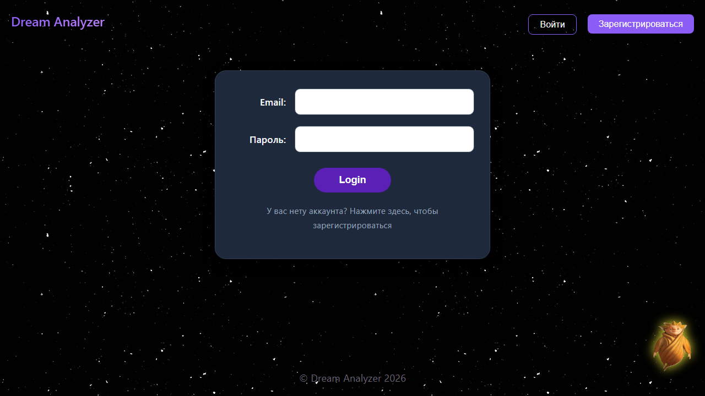

# Отчет об автоматизации UI-тестов (Playwright)

**Дата:** 2026-10-19  
**Инструмент:** Playwright (C#, NUnit)  
**Окружение:** Localhost.

## Реализация требований задания:

1. **Паттерн Page Object:**
   Для изоляции логики работы со страницами реализованы два класса:
   * `LoginPage.cs` (инкапсулирует поля ввода и кнопку входа).
   * `DreamsPage.cs` (инкапсулирует кнопку добавления сна, поля формы и заголовок страницы).
   Тесты не содержат CSS-селекторов напрямую, что позволяет легко поддерживать их при изменении верстки.

2. **Независимость тестов и свои данные:**
   В методе `[SetUp]` перед каждым тестом генерируется уникальный email через `Guid.NewGuid()` и создается новый пользователь через API. Для теста создания сна также генерируется уникальный заголовок сна. Это гарантирует, что тесты не зависят от порядка запуска и не засоряют базу данных.

3. **Явные ожидания (Explicit Waits):**
   Вместо фиксированных пауз (`Thread.Sleep`) используются явные ожидания Playwright:
   * `WaitForSelectorAsync` — ожидание появления формы входа на экране.
   * `WaitForURLAsync` — ожидание смены URL после успешного логина или создания сна.
   * `WaitForDialogAsync` — ожидание появления системного `alert` при вводе неверного пароля.

4. **Скриншот при падении:**
   В методе `[TearDown]` реализована проверка статуса теста. Если тест завершается с ошибкой (`TestStatus.Failed`), Playwright автоматически делает полный скриншот страницы и сохраняет его в директорию проекта (папка `bin/Debug`).

## Результаты прогона
Все 3 сценария успешно пройдены (3 succeeded, 0 failed):
1. `SuccessLogin_RedirectsToDreamsPage` — позитивный логин и проверка перехода на страницу снов.
2. `Login_WithWrongPassword_ShowsAlert` — негативный логин, проверка текста ошибки в alert и отсутствия перехода.
3. `CreateDream_Success_AppearsInList` — создание сна через UI и проверка его отображения в списке.
4. `SearchDream_FiltersResults` — проверка работы поиска (фильтрации списка снов).

*Скриншот успешного прогона (4 теста):*

*Пример скриншота, автоматически сохраненного при падении теста (доказательство работы TearDown):*
