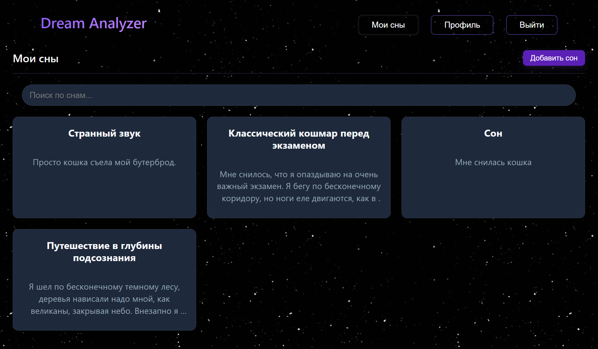
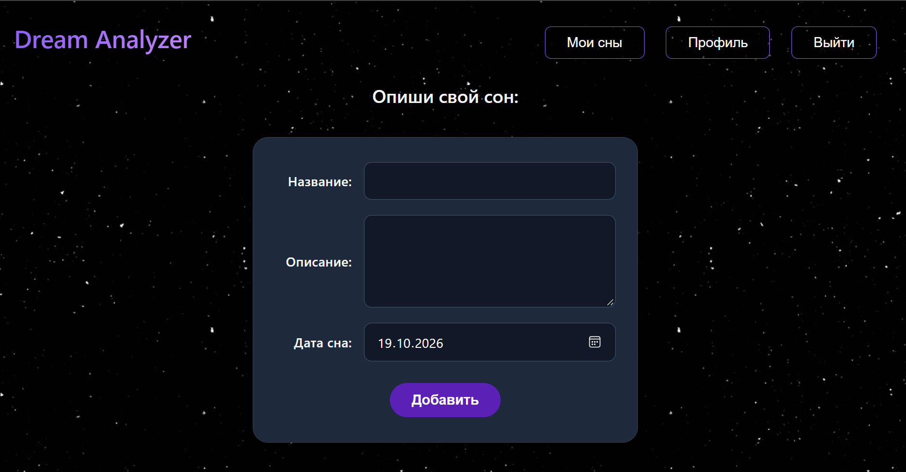
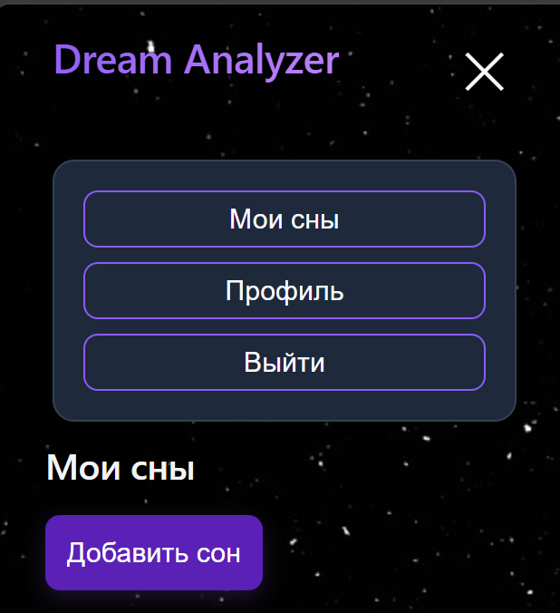
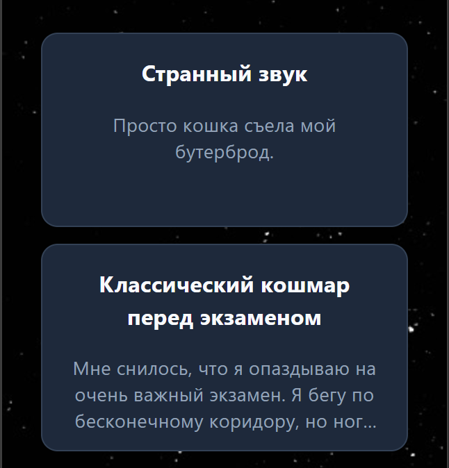
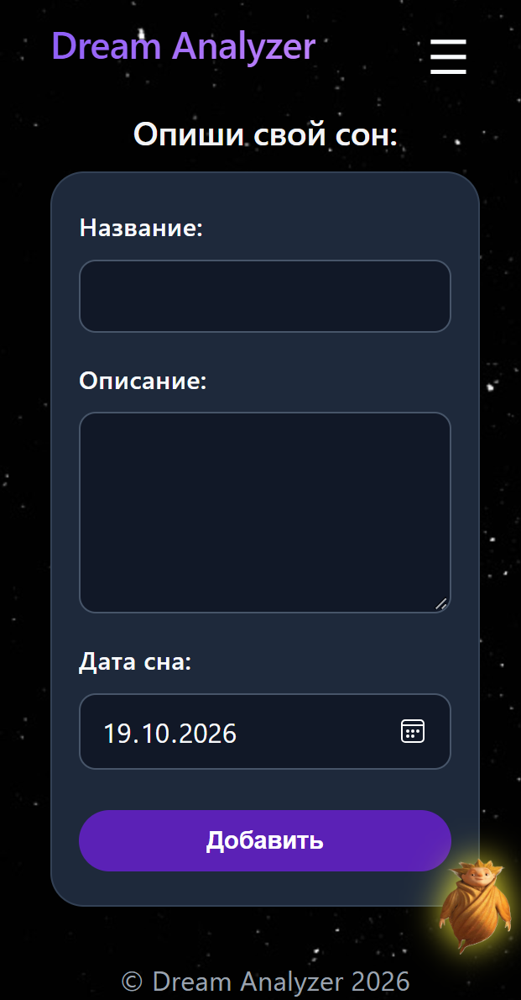
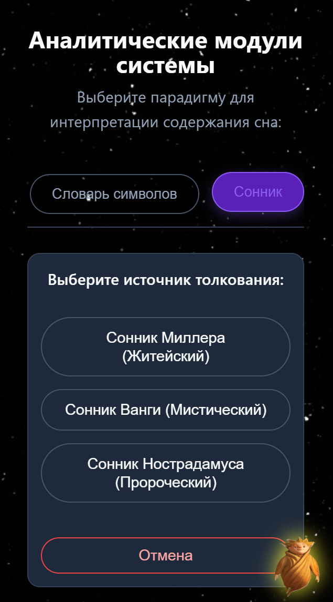
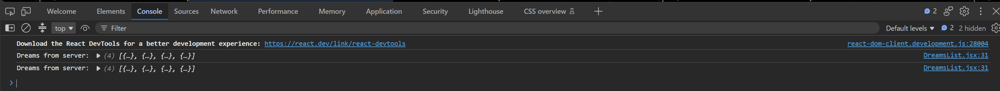
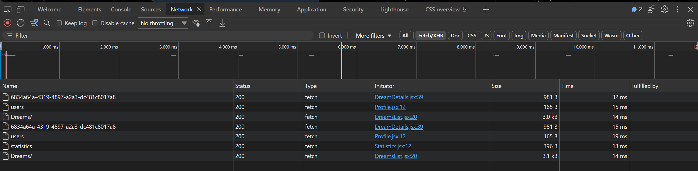
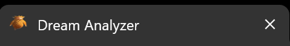

# Отчет о тестировании вёрстки и совместимости (UI Testing Report)

**Дата:** 2026-10-18  
**Окружение:** Localhost (frontend: https://localhost:4050), ОС Windows.  
**Инструменты:** DevTools (Chrome, Firefox, Edge).

## 1. Визуальная часть
*   **Целостность блоков:** Карточки снов (`.dreamCard`) выровнены ровно, нет наложений текста. Кнопки не вылезают за пределы контейнеров.
*   **Сетка:** Сетка карточек адаптивна (от 1 колонки на мобильных до 3-4 на десктопе).
*   **Текст вокруг изображений:** Песочный человек на главной не перекрывает текст и кнопки (проверено).

## 2. Адаптивность
*   **Мобильная версия (320px - 768px):** Реализовано бургер-меню, формы ввода корректно сжимаются, таблицы админки скроллятся вбок.
*   **Планшет (1024px):** Сетка карточек перестраивается, отступы сохраняются.
*   **Десктоп (1920px):** Контент центрирован, максимальная ширина ограничена `1400px`.
*   **Масштабирование:** При увеличении масштаба страницы (Ctrl + +) верстка не ломается.

## 3. Интерактивные элементы
*   **Кликабельность:** Все кнопки и ссылки кликабельны, курсор меняется на `pointer`.
*   **Фокус:** При нажатии `Tab` в полях форм появляется рамка (outline) фокуса.
*   **Hover:** Кнопки навигации и карточки снов меняют цвет при наведении.
*   **Логотип:** Клик по логотипу "Dream Analyzer" переводит на главную страницу.
*   **Favicon:** Иконка сайта отображается во вкладке браузера.

## 4. Работа с реальными данными
*   **Длинные строки:** Создан сон с длинным текстом (500+ символов). Текст корректно обрезается с многоточием (`...`), верстка не ломается.
*   **Короткие строки:** Создан сон с коротким текстом. Карточка сохраняет минимальную высоту.
*   **Пустые списки:** При отсутствии снов отображается сообщение "У вас пока нет снов".
*   **Много элементов:** Создано 10+ снов, список корректно скроллится.

## 5. Отсутствие ошибок
*   **Ошибки 404:** В DevTools (вкладка Network) все запросы к API возвращают статусы 200 OK.
*   **Ошибки в консоли:** Вкладка Console чистая, нет красных ошибок JavaScript.

---

## 6. Таблица совместимости «Проверка × Браузер»

| Проверка | Chrome | Firefox | Edge |
| :--- | :--- | :--- | :--- |
| Отображение главной страницы | + | + | + |
| Отображение списка снов | + | + | + |
| Работа бургер-меню (мобильная версия) | + | + | + |
| Кликабельность кнопок и ссылок | + | + | + |
| Отображение длинного текста (без обрезки пополам) | + | + | + |
| Отсутствие ошибок в Console | + | + | + |
| Адаптивность (320px) | + | + | + |

---

## 7. Доказательства (Скриншоты)

### Десктопная версия
*   **Список снов (ровная сетка):** 
    
*   **Форма добавления (ровные отступы):**
    

### Мобильная версия (320px)
*   **Бургер-меню в открытом состоянии:**
    
*   **Список снов:**
    
*   **Форма добавления (адаптивная):**
    
*   **Выбор сонника (компактный вид):**
    

### Отсутствие ошибок (DevTools)
*   **Вкладка Console (чисто):**
    
*   **Вкладка Network (нет 404):**
    
*   **Favicon во вкладке:**
    

---

**Вывод:** В ходе тестирования было выявлено несколько дефектов адаптивности (отсутствие бургер-меню, некорректное отображение форм и карточек на 320px). Все найденные дефекты были успешно исправлены (см. ISSUES.md). На текущий момент верстка адаптивна, кроссбраузерна, критических дефектов UI не выявлено.