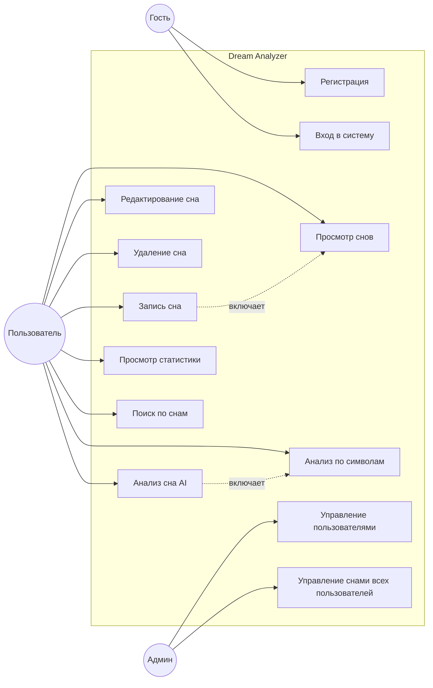

# Спецификация требований — Dream Analyzer

**Версия:** 1.0  
**Дата:** 2026-10-10  
**Автор:** Marozava Evelina

---

## 1. Бизнес-требования

### 1.1 Назначение системы

**Dream Analyzer** — веб-приложение для ведения дневника сновидений с функциями автоматического анализа, интерпретации и статистики.

### 1.2 Решаемая проблема

| Проблема | Существующие решения |
|----------|---------------------|
| Дневники снов только записывают, но не анализируют | «Dream Journal», «Awoken» |
| Онлайн-сонники не учитывают контекст всего сна | Сонник Миллера, dreammoods.com |
| Нет единого инструмента для записи + анализа + статистики | — |
| AI-анализ снов недоступен в готовых продуктах | — |

### 1.3 Цели системы

| ID | Цель |
|----|------|
| BR-01 | Дать пользователю удобный инструмент для записи снов |
| BR-02 | Предоставить 5 различных методов анализа снов (Символы, Фрейд, Юнг, КПТ, Сонник) |
| BR-03 | Позволить отслеживать статистику по снам (настроения, символы, дни недели) |
| BR-04 | Обеспечить безопасное хранение личных данных пользователей |
| BR-05 | Дать администратору инструменты управления пользователями и контентом |

---

## 2. Пользовательские требования (Use Cases)

### UC-01: Регистрация нового пользователя
**Актор:** Гость  
**Предусловие:** Пользователь не авторизован  
**Основной поток:**
1. Гость открывает форму регистрации
2. Вводит username, email, пароль
3. Система проверяет уникальность email
4. Система хеширует пароль (BCrypt) и сохраняет пользователя
5. Система возвращает JWT-токен

**Постусловие:** Пользователь авторизован, токен сохранён в localStorage

---

### UC-02: Запись нового сна
**Актор:** Авторизованный пользователь  
**Предусловие:** Пользователь вошёл в систему  
**Основной поток:**
1. Пользователь открывает форму создания сна
2. Вводит заголовок, содержание, дату сна
3. Система валидирует данные
4. Система сохраняет сон в БД, привязав к пользователю

**Постусловие:** Сон отображается в списке снов пользователя

---

### UC-03: Анализ сна с помощью AI
**Актор:** Авторизованный пользователь  
**Предусловие:** Сон создан  
**Основной поток:**
1. Пользователь открывает страницу сна
2. Выбирает стратегию анализа (Фрейд / Юнг / КПТ / Символы / Сонник)
3. Система отправляет запрос в AI или в словарь символов
4. Система сохраняет результат анализа
5. Система отображает толкование, настроение, символы

**Постусловие:** Анализ сохранён и привязан к сну

---

### UC-04: Просмотр статистики
**Актор:** Авторизованный пользователь  
**Предусловие:** У пользователя есть хотя бы один сон  
**Основной поток:**
1. Пользователь открывает профиль
2. Переключается на вкладку «Статистика»
3. Система агрегирует данные: всего снов, средняя длина, распределение по дням недели, настроения, топ-5 символов

**Постусловие:** Пользователь видит визуализацию статистики

---

### UC-05: Администрирование пользователей
**Актор:** Администратор  
**Предусловие:** Пользователь имеет роль Admin  
**Основной поток:**
1. Админ открывает раздел «Админка»
2. Просматривает список пользователей и снов
3. Удаляет пользователя или сон

**Постусловие:** Изменения применены

---

### UC-06: Поиск по снам
**Актор:** Авторизованный пользователь  
**Основной поток:**
1. Пользователь вводит ключевое слово в строку поиска
2. Система фильтрует сны по заголовку и содержанию
3. Отображаются подходящие результаты

---

### Use Case диаграмма

---

## 3. Функциональные требования

| ID | Требование | Приоритет |
|----|-----------|-----------|
| FR-01 | Система должна регистрировать пользователя по username, email и паролю | Must |
| FR-02 | Система должна проверять уникальность email при регистрации | Must |
| FR-03 | Система должна хешировать пароль (BCrypt) перед сохранением | Must |
| FR-04 | Система должна возвращать JWT-токен после регистрации и логина | Must |
| FR-05 | Система должна разграничивать доступ по ролям (User, Admin) | Must |
| FR-06 | Пользователь должен иметь возможность создавать сон (заголовок, текст, дата) | Must |
| FR-07 | Пользователь должен видеть только свои сны | Must |
| FR-08 | Пользователь должен редактировать и удалять свои сны | Must |
| FR-09 | Система должна выполнять анализ сна стратегией «Словарь символов» (стемминг + БД) | Must |
| FR-10 | Система должна выполнять анализ сна стратегией «Психоанализ Фрейда» (AI) | Must |
| FR-11 | Система должна выполнять анализ сна стратегией «Архетипы Юнга» (AI) | Must |
| FR-12 | Система должна выполнять анализ сна стратегией «КПТ-анализ» (AI) | Must |
| FR-13 | Система должна выполнять анализ сна стратегией «Сонник» (Миллер / Ванга / Нострадамус) | Should |
| FR-14 | Система должна отображать статистику: количество снов, средняя длина, настроения, топ-символы | Must |
| FR-15 | Система должна предоставлять поиск по снам (по заголовку и содержанию) | Should |
| FR-16 | Админ должен видеть список всех пользователей | Must |
| FR-17 | Админ должен видеть список всех снов всех пользователей | Must |
| FR-18 | Админ должен удалять пользователей и сны | Should |
| FR-19 | Система должна возвращать унифицированный `ApiResponse<T>` для всех эндпоинтов | Must |
| FR-20 | Система должна обрабатывать исключения через глобальный middleware | Must |
| FR-21 | Система должна предоставлять Swagger-документацию API | Should |
| FR-22 | Система должна сохранять историю анализов (какой стратегией анализировался сон) | Must |

---

## 4. Нефункциональные требования

| ID | Требование | Категория |
|----|-----------|-----------|
| NFR-01 | Время отклика API на запросы без AI — не более 500 мс (при 100 записях) | Производительность |
| NFR-02 | Время анализа через AI — не более 15 секунд | Производительность |
| NFR-03 | Пароли должны храниться только в хешированном виде (BCrypt, cost factor 10) | Безопасность |
| NFR-04 | JWT-токены должны иметь срок жизни 24 часа и подписываться алгоритмом HS256 | Безопасность |
| NFR-05 | Интерфейс должен быть адаптивным (корректно работать на экранах от 320px) | Удобство |
| NFR-06 | Система должна поддерживать тёмную тему оформления | Удобство |
| NFR-07 | Код должен быть покрыт модульными тестами не менее чем на 70% | Качество |
| NFR-08 | Архитектура должна обеспечивать замену AI-провайдера без изменения бизнес-логики | Поддерживаемость |
| NFR-09 | Система должна корректно обрабатывать ошибки БД и AI (не падать) | Надёжность |
| NFR-10 | Все секреты (ключи, пароли) должны храниться вне репозитория (User Secrets / env) | Безопасность |
| NFR-11 | Приложение должно работать в браузерах Chrome, Firefox, Edge последних версий | Совместимость |
| NFR-12 | Исходный код должен быть размещён на GitHub с документацией | Документирование |
