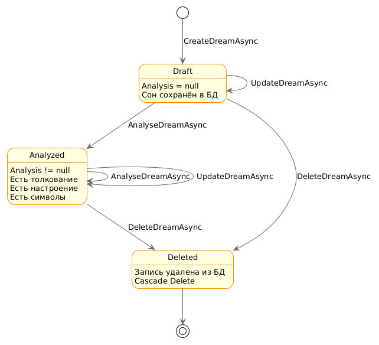

# Диаграмма состояний сущности Dream

**Дата:** 2026-10-10  
**Автор:** Marozava Evelina

---

## 1. Выбор сущности

**Сущность:** `Dream` (сон)

**Обоснование:** сон — центральная сущность системы, которая проходит 
через несколько состояний в течение жизненного цикла: от создания 
до анализа и удаления.

---

## 2. Состояния сущности

| Состояние | Описание | Условие |
|-----------|----------|---------|
| **Draft** | Сон создан, но ещё не проанализирован | `Analysis == null` |
| **Analyzed** | Есть результат анализа (толкование, настроение, символы) | `Analysis != null` |
| **Deleted** | Сон удалён из системы | Запись удалена из БД |

**Начальное состояние:** `Draft`  
**Конечное состояние:** `Deleted`

---

## 3. Переходы между состояниями

| № | Из | В | Событие / Условие | Метод |
|---|-----|-----|-------------------|-------|
| 1 | *(начало)* | Draft | Пользователь нажал «Добавить сон» и заполнил форму | `CreateDreamAsync` |
| 2 | Draft | Draft | Пользователь отредактировал сон | `UpdateDreamAsync` |
| 3 | Draft | Analyzed | Пользователь выбрал стратегию анализа, AI вернул результат | `AnalyseDreamAsync` |
| 4 | Analyzed | Analyzed | Пользователь повторно проанализировал сон другой стратегией | `AnalyseDreamAsync` + `analysis.Update()` |
| 5 | Analyzed | Analyzed | Пользователь отредактировал сон | `UpdateDreamAsync` |
| 6 | Draft | Deleted | Пользователь подтвердил удаление | `DeleteDreamAsync` |
| 7 | Analyzed | Deleted | Пользователь подтвердил удаление | `DeleteDreamAsync` |
| 8 | Deleted | *(конец)* | — | — |

---

## 4. Диаграмма состояний

